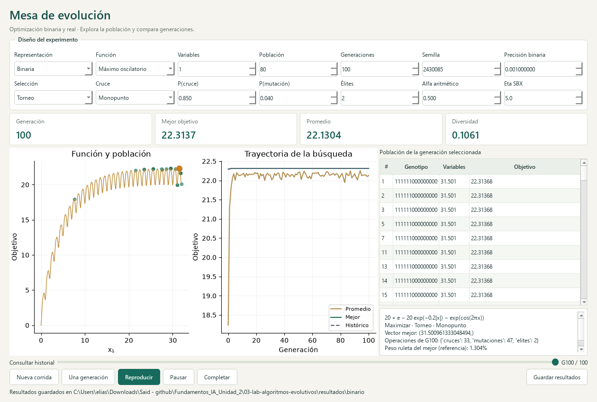
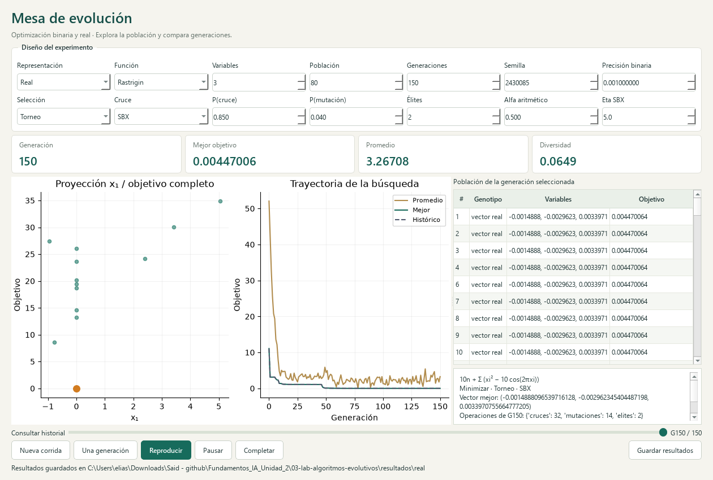

# Laboratorio de algoritmos evolutivos

Interfaz Mesa de evolución para explorar optimización numérica con cromosomas binarios o reales. El algoritmo está implementado en [optimizacion.py](../ia_unidad2/optimizacion.py) y la ventana en [ventana_laboratorio.py](../ia_unidad2/ventana_laboratorio.py).

Desde la raíz de la unidad:

    python iniciar.py laboratorio

## Uso

1. Elige representación, función, variables y operadores.
2. Pulsa Nueva corrida para aplicar la configuración. La población inicial es G0.
3. Usa Una generación, Reproducir, Pausar o Completar.
4. Mueve el control del historial para consultar una generación. Las tablas muestran genotipo, coordenadas y objetivo.
5. Guarda la corrida para obtener JSON, CSV de evolución y población, y una gráfica.

Los cambios en los campos se aplican al iniciar una nueva corrida. El algoritmo mantiene la semilla y configuración de la corrida actual.

## Funciones y operadores

- Máximo oscilatorio: 20 + e − 20 exp(−0.2|x|) − exp(cos(2πx)), en [0,32].
- Mínimo oscilatorio: −|x sen(√|x|)|, en [−250,250].
- Schwefel acotada: suma de −xi sen(√|xi|), en [0,100].
- Rastrigin: 10n + suma de xi² − 10 cos(2πxi), en [−5.12,5.12].
- Esfera: suma de xi², en [−5,5].

La codificación binaria calcula la cantidad de bits a partir de la precisión y decodifica ambos extremos del dominio. Usa cruce monopunto y mutación por bit. La real admite cruce monopunto, uniforme, aritmético y SBX, y mutación uniforme por gen. SBX se recorta a los límites del dominio.

La selección puede ser torneo de tres participantes, ruleta o SUS. La ruleta desplaza los objetivos para obtener pesos positivos tanto al minimizar como al maximizar. Las élites se conservan sin modificación; se admiten poblaciones impares.

La diversidad binaria es la media de 2p(1−p) por posición. La real es la desviación típica media por variable, normalizada por la amplitud del dominio. Son indicadores distintos. Para varias variables, la gráfica izquierda muestra x₁ frente al objetivo completo, no una función de una sola variable.

## Ejecuciones incluidas

- [Demostración binaria](resultados/binario/): objetivo 22.3136766, en 100 generaciones.
- [Demostración real](resultados/real/): Rastrigin de tres variables, objetivo 0.00447006, en 150 generaciones.
- [Estudio de 40 corridas](resultados/estudio/): cinco semillas por problema y representación.

[estudio.py](estudio.py) compara configuraciones completas: cambian representación, cruce y probabilidad/unidad de mutación. Las diferencias no se atribuyen únicamente a la codificación. Ninguna de estas corridas garantiza el óptimo global en otros problemas o semillas.

### Representación binaria

### Representación real

