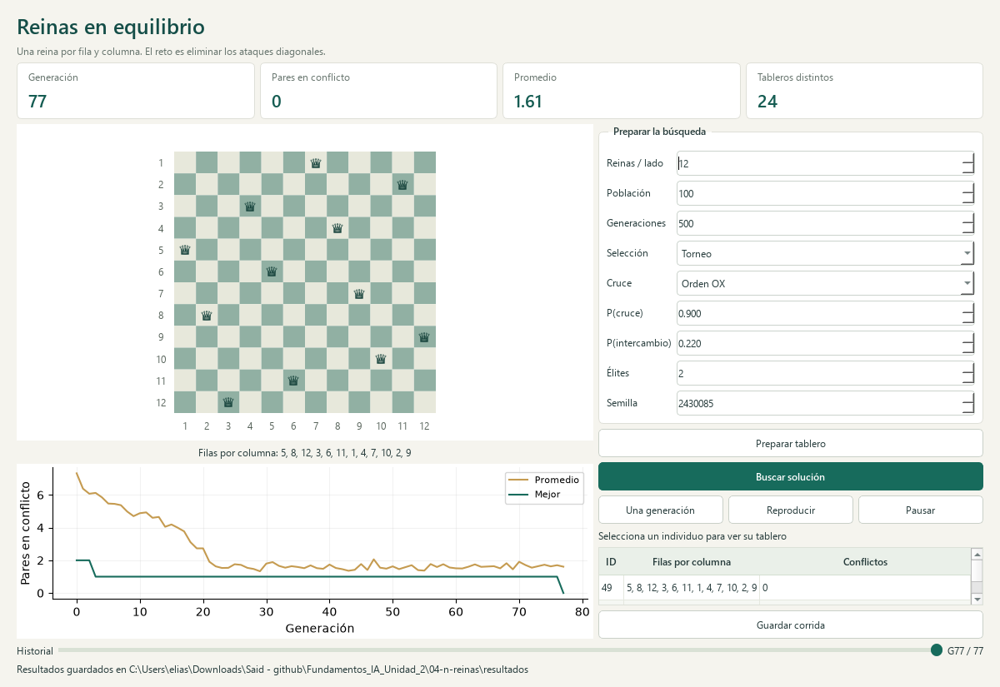

# Problema de las N reinas

Aplicación Reinas en equilibrio. Utiliza un cromosoma de N valores: la posición indica la columna y el valor indica la fila. Al ser una permutación, no se repiten filas ni columnas; el objetivo es minimizar los pares que comparten diagonal.

Desde la raíz:

    python iniciar.py reinas

## Uso

1. Configura N, población, generaciones, operadores y semilla.
2. Pulsa Preparar tablero para crear la población inicial.
3. Busca una solución completa o avanza por generaciones. Pausar conserva la corrida.
4. Selecciona un individuo en la tabla para inspeccionar su tablero. Las líneas rojas muestran las parejas que se atacan.
5. Usa el historial para consultar una generación anterior y Guarda corrida para exportar.

El motor está en [reinas.py](../ia_unidad2/reinas.py) y la interfaz en [ventana_reinas.py](../ia_unidad2/ventana_reinas.py).

## Algoritmo

Selección por torneo o ruleta con peso 1/(1+conflictos), cruce por orden OX o ciclos CX, mutación por intercambio y elitismo. Los operadores mantienen las permutaciones. Cada pareja se cuenta una sola vez.

El ejemplo predeterminado usa 12 reinas y semilla 2430085. Encontró cero conflictos en G77, con las filas 5, 8, 12, 3, 6, 11, 1, 4, 7, 10, 2, 9, mostradas desde 1. La solución se [verificó contando todos los pares](resultados/solucion.json).

La interfaz admite N de 1 a 32. N=2 y N=3 no tienen solución; se pueden ejecutar para observar el límite de generaciones. Para otros tamaños, una búsqueda que no encuentra solución no demuestra que no exista. La aplicación no introduce soluciones conocidas en la población.

El archivo JSON conserva la configuración y el historial; los [resultados](resultados/) incluyen además CSV, tablero y curva.

