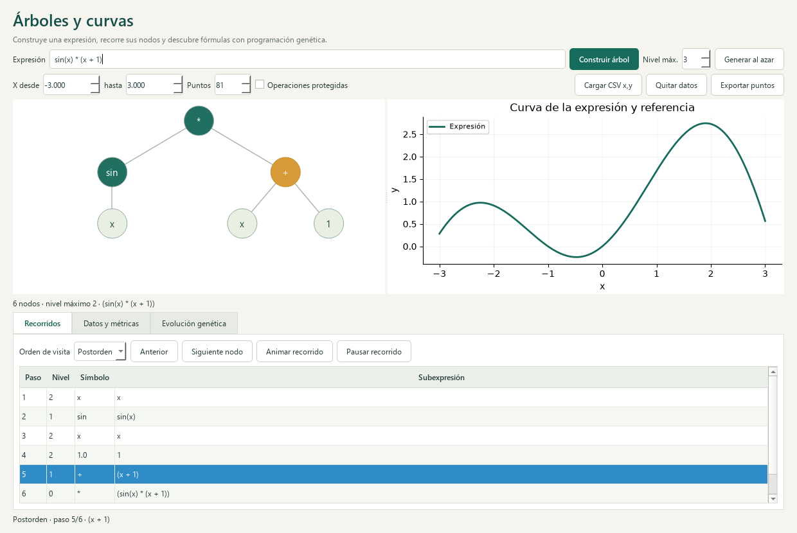
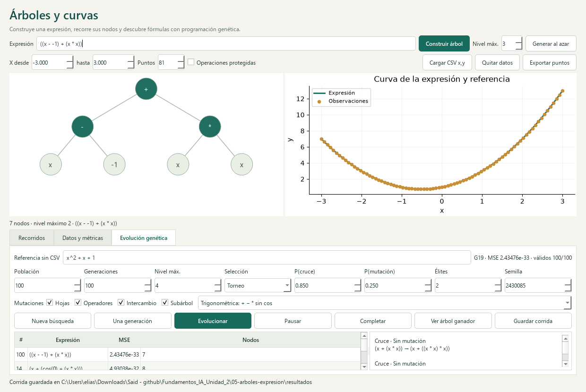

# Árboles de expresión y programación genética

Aplicación Árboles y curvas. Su [intérprete](../ia_unidad2/expresiones.py) construye árboles matemáticos sin ejecutar código del texto introducido. La [interfaz](../ia_unidad2/ventana_arboles.py) muestra el árbol y la curva al mismo tiempo.

    python iniciar.py arboles

## Explorador

Introduce una expresión con multiplicaciones explícitas, como sin(x)*(x+1), y pulsa Construir árbol. También puedes generar una expresión aleatoria. Los recorridos preorden, inorden y postorden se animan o se inspeccionan paso a paso. Pulsar un nodo lo selecciona en el recorrido.

Se admiten +, −, *, / y potencia con ^, signos unarios, constantes pi y e, y las funciones sin, cos, tan, asin, acos, atan, sqrt, exp, log, ln, log10, abs, floor y ceil. Los ángulos usan radianes. El parser limita el texto a 2000 caracteres, doce niveles y 127 nodos; no admite atributos, índices ni llamadas arbitrarias. La raíz se cuenta en el nivel 0.

Por defecto, los errores de dominio se conservan como puntos inválidos y las curvas dejan huecos. Las operaciones protegidas son opcionales: división con denominador casi cero devuelve 1, la raíz utiliza valor absoluto y el logaritmo utiliza el valor absoluto con suelo 1e-12. La potencia limita la magnitud del exponente a 64 para evitar operaciones numéricas desmesuradas.

## Datos y métricas

Carga CSV con dos columnas x,y y encabezado opcional. Se aceptan coma o punto y coma, BOM y filas vacías. Los números no finitos y las filas inválidas se rechazan. Se conservan todos los puntos, incluidos valores x repetidos.

La comparación calcula MSE, RMSE, NMSE y R² sobre todas las observaciones. Si una predicción no es válida, no se calcula una métrica parcial que pueda ocultar ese fallo. NMSE y R² no se definen cuando la referencia es constante.

Puedes [probar el CSV incluido](datos/ejemplo_cuadratico.csv). Exportar puntos guarda las muestras válidas del intervalo y avisa cuántas se conservaron.

## Programación genética

En Evolución genética utiliza los datos cargados o escribe una referencia matemática. Nueva búsqueda fija los datos y parámetros de la corrida; Una generación, Evolucionar, Pausar y Completar controlan el proceso. Ver árbol ganador transfiere el genotipo directamente al explorador.

El motor implementa inicialización aleatoria, torneo o ruleta, intercambio de subárboles, elitismo y cuatro tipos de mutación: hojas, operadores, intercambio de hijos y subárbol nuevo. Los límites de nivel y 127 nodos se mantienen durante las operaciones. No se inserta la referencia en la población. Una predicción inválida penaliza al individuo completo.

La búsqueda minimiza MSE y usa menor cantidad de nodos para desempatar. Para al alcanzar la tolerancia 1e-8 o el límite de generaciones. El registro muestra operaciones efectivamente realizadas sobre hijos de cada generación.

La demostración usó 81 puntos de x²+x+1 y encontró (x−(−1))+x*x en G19, con MSE aproximado 2.43e-33. Es un ajuste sobre los datos de ejemplo, no una evaluación sobre un conjunto externo. Consulta [regresion.json](resultados/regresion.json), [predicciones.csv](resultados/predicciones.csv) y el [historial](resultados/historial.csv).

### Exploración y recorrido

### Regresión simbólica

