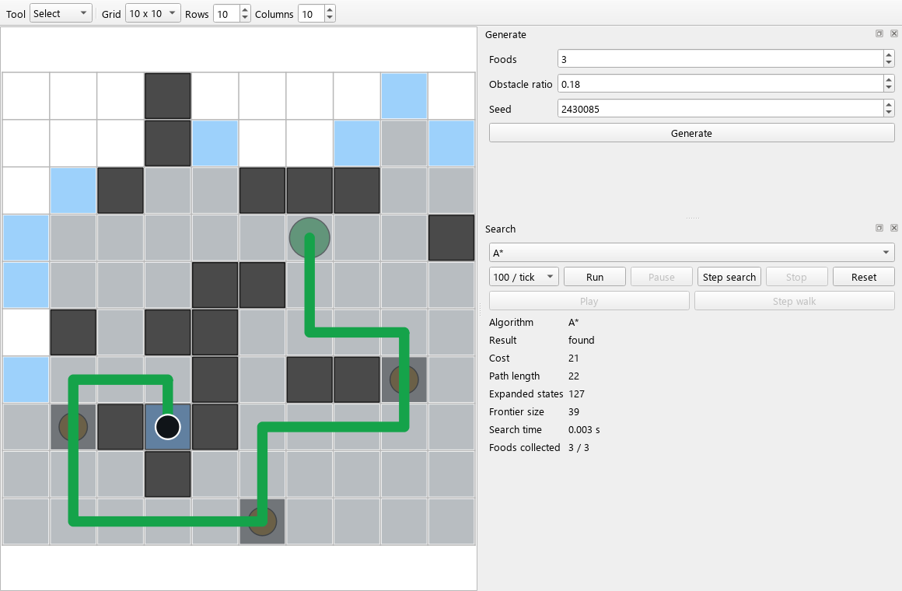
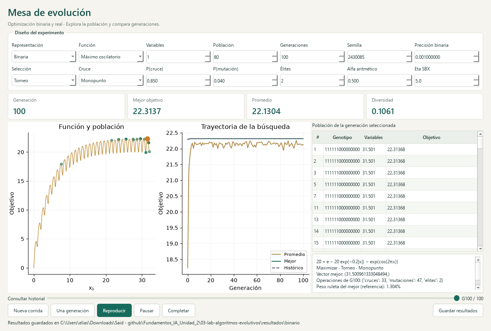
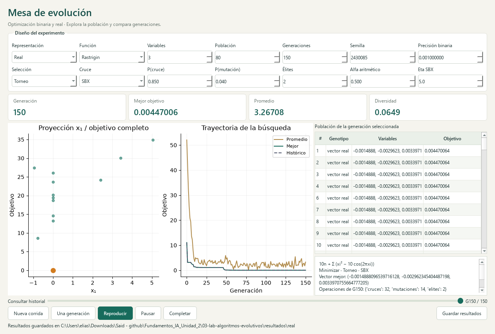
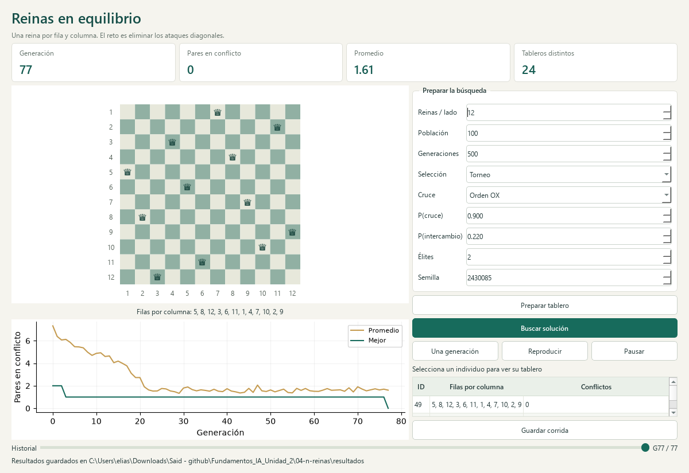
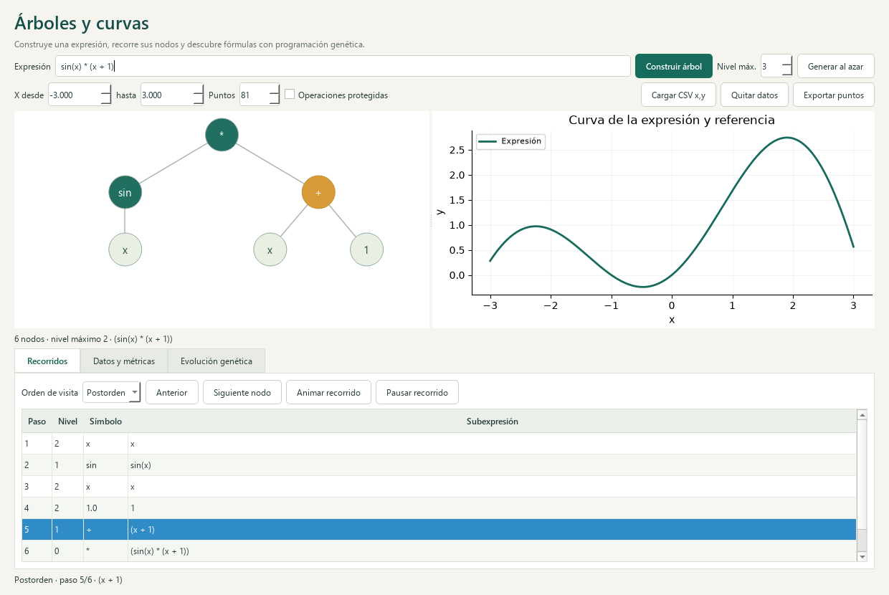
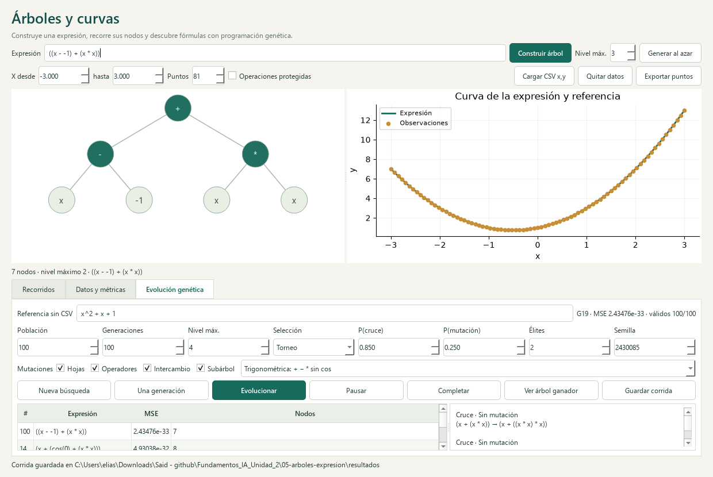

# Fundamentos de Inteligencia Artificial · Unidad 2

**Elias de Jesus Zuñiga de Leon** · **Matrícula: 2430085**

Actividades realizadas en la unidad 2 de Fundamentos de Inteligencia Artificial.

## 1. Problema de la hormiga

Aplicación del equipo para encontrar una ruta que recoja todos los alimentos y llegue a la meta en una cuadrícula con obstáculos. Permite editar el mapa y ejecutar BFS, Dijkstra y A*.

En la demostración se recogieron tres alimentos con una ruta de costo 21. Los tres algoritmos coincidieron en el costo.

[Proyecto del equipo](01-problema-hormiga/) · [Resultados de la ejecución](01-problema-hormiga/resultados/verificacion_equipo.json)

## 2. Visualizador de grafos

Pendiente de agregar.

## 3. Laboratorio de algoritmos evolutivos

Optimización de funciones mediante algoritmos genéticos con representaciones binarias y reales. La interfaz permite configurar los operadores, avanzar por generaciones, consultar la población y guardar los resultados.

[Código y actividad](03-lab-algoritmos-evolutivos/)

### 3.1. Representación binaria

Se maximizó una función oscilatoria con cromosomas binarios. La corrida obtuvo un objetivo de 22.3136766 cerca de x = 31.50096.

### 3.2. Representación real

Se minimizó Rastrigin con tres variables usando cruce SBX. Después de 150 generaciones, el mejor objetivo fue 0.00447006.

## 4. Problema de las N reinas

Búsqueda de una disposición sin ataques mediante un algoritmo genético. Los individuos son permutaciones y la interfaz permite inspeccionar tableros, conflictos e historial de la población.

La demostración encontró una solución para 12 reinas, con cero pares en conflicto, en la generación 77.

[Código y actividad](04-n-reinas/) · [Solución obtenida](04-n-reinas/resultados/solucion.json)

## 5. Árboles de expresión y programación genética

Construcción de árboles a partir de expresiones matemáticas, recorridos de nodos, evaluación de curvas y comparación con observaciones CSV.

[Código y actividad](05-arboles-expresion/)

### 5.1. Exploración del árbol y su curva

Se construyó y recorrió el árbol de la expresión sin(x) × (x + 1).

### 5.2. Regresión simbólica

Se aplicó programación genética a 81 puntos de ejemplo de x² + x + 1. La búsqueda encontró la expresión equivalente (x − (−1)) + x × x en la generación 19, con un MSE cercano a cero.

